

# Copenhagen metro operations monitoring app

* Author: Kiril (GitHub@cyrilby)
* Website: [mindgraph.dk](https://mindgraph.dk)
* Last meaningful update: 19-11-2026

This repository contains the source code of the [Streamlit app](https://cph-metro.streamlit.app/) that presents insights on the Copenhagen Metro's operational status data, which is collected and processed in a [separate repository](https://github.com/cyrilby/cph-metro-status).

This `README` file outlines how the app is built.

## Requirements

- Python 3.12.10
- Python packages as specified in the `requirements.txt` file

The app relies mostly on `duckdb` for data import and `plotly` for creating visuals.

## Functionalities

The two most important aspects of the app are its **pages** and its **filters**, which are both described below.

### Pages in the app

Each page contains various visual elements and accompanying text. A page typically covers a certain topic as indicated by its title. The table below summarizes what you will find on each page.

| Page | Preview | Description |
|------|---------|-------------|
| **Welcome** | 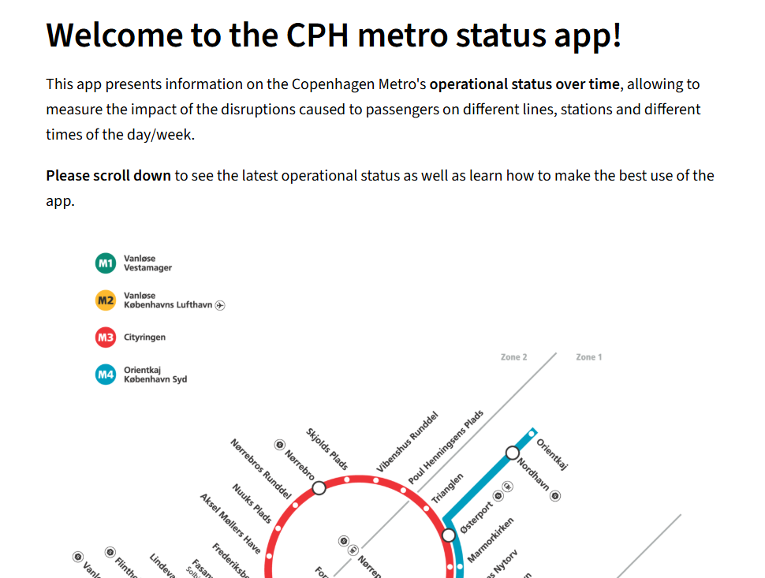 | Landing page of the app, contains the latest processed metro status and instructions on how to use the app |
| **Overview** | 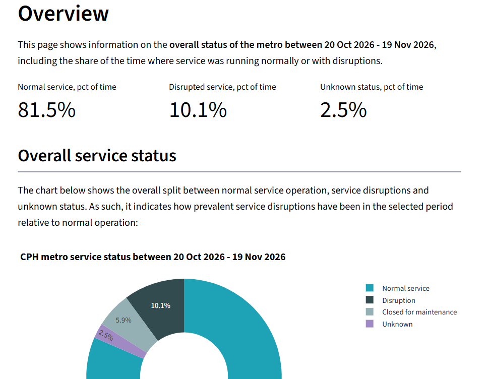 | Contains overall and more detailed service status (e.g. normal service, disruptions) and the % of time accounted for |
| **Daily reliability** | 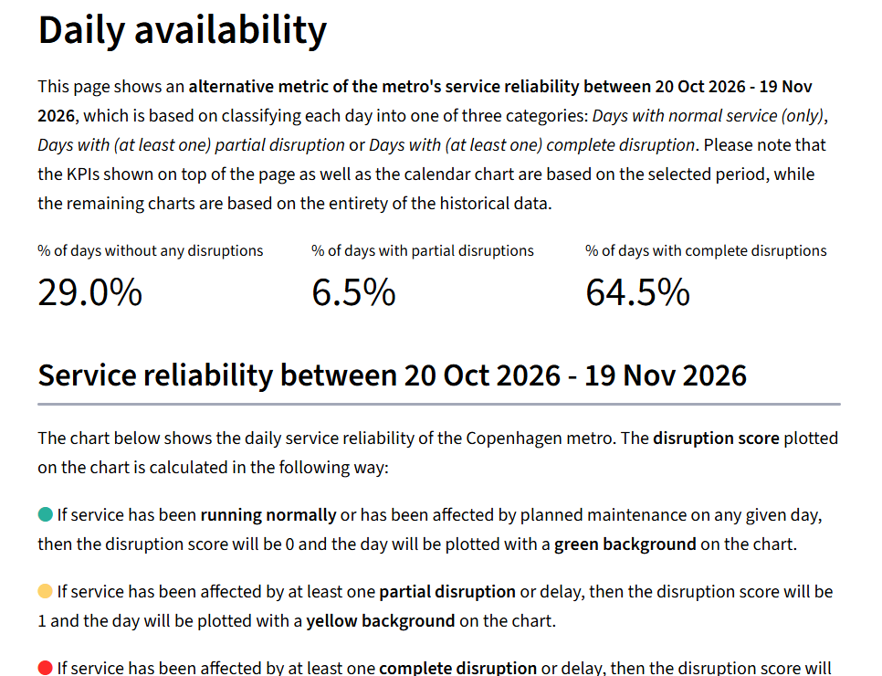 | Presents an alternative metric of the metro's reliability by looking at whether there have been any service disruptions in the course of a given day |
| **Disruption reasons** | 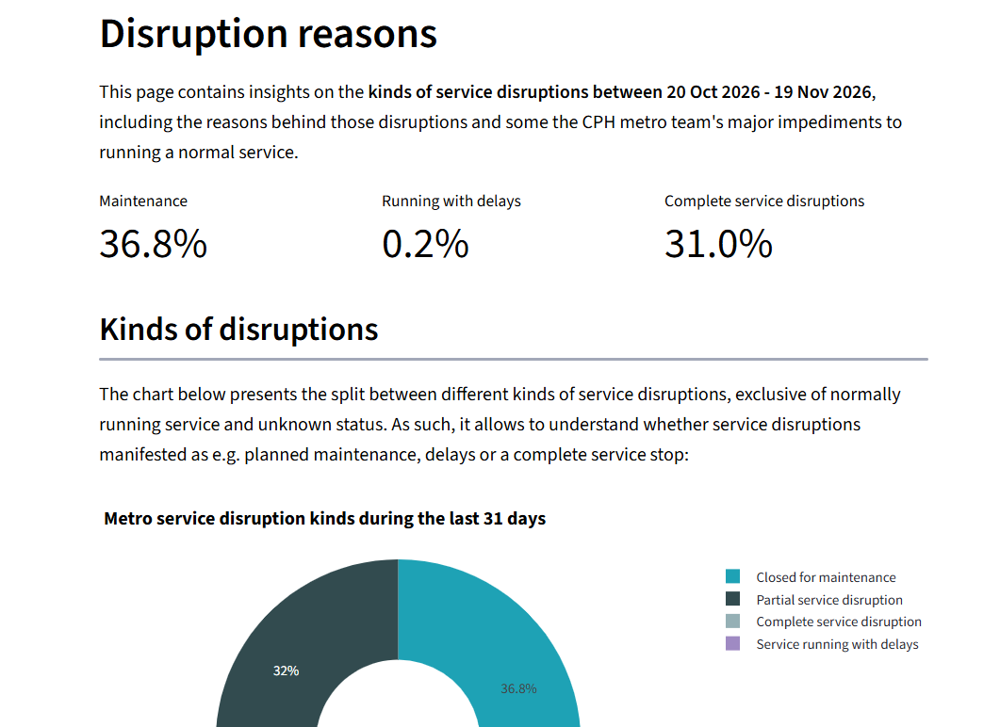 | Shows a split of different disruption types and the main reasons behind the various disruptions |
| **Disruption impact** | 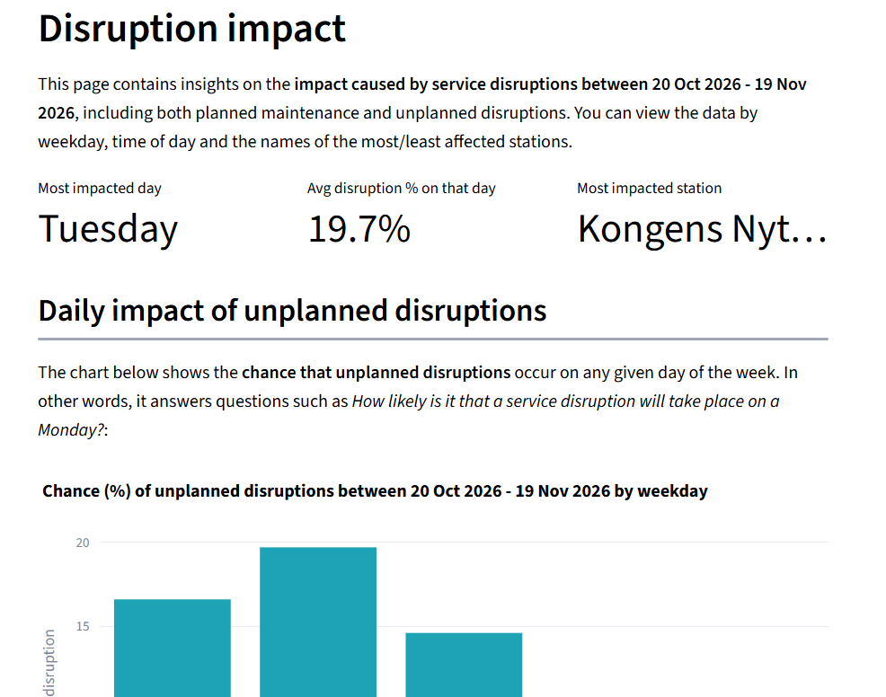 | Shows the likelihood that a service disruption will occur on a certain weekday or in a certain time interval (e.g. rush hour), as well as the most and least impacted stations |
| **Disruption history** | 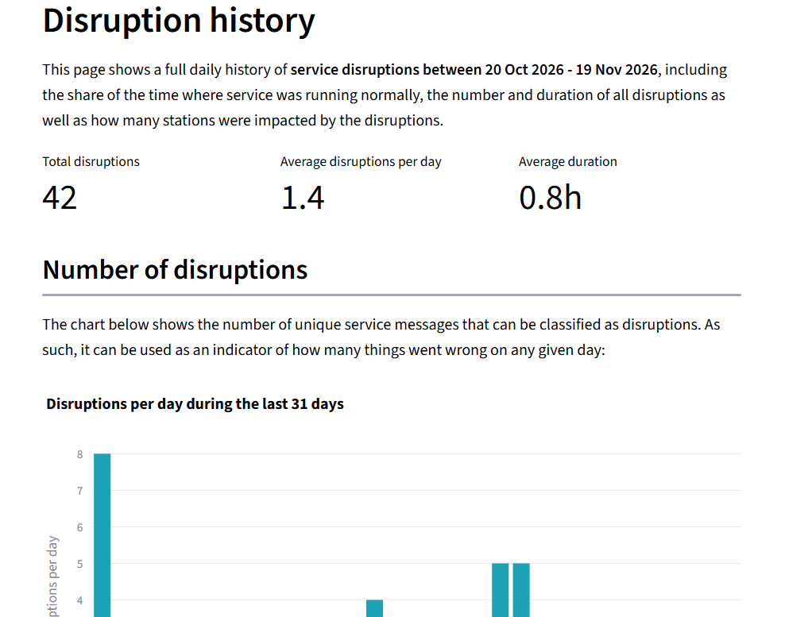 | Contains the number of disruptions over time as well as the % of time with disruptions, the average duration of disruptions and the number of affected stations |
| **Disruption calculator** | 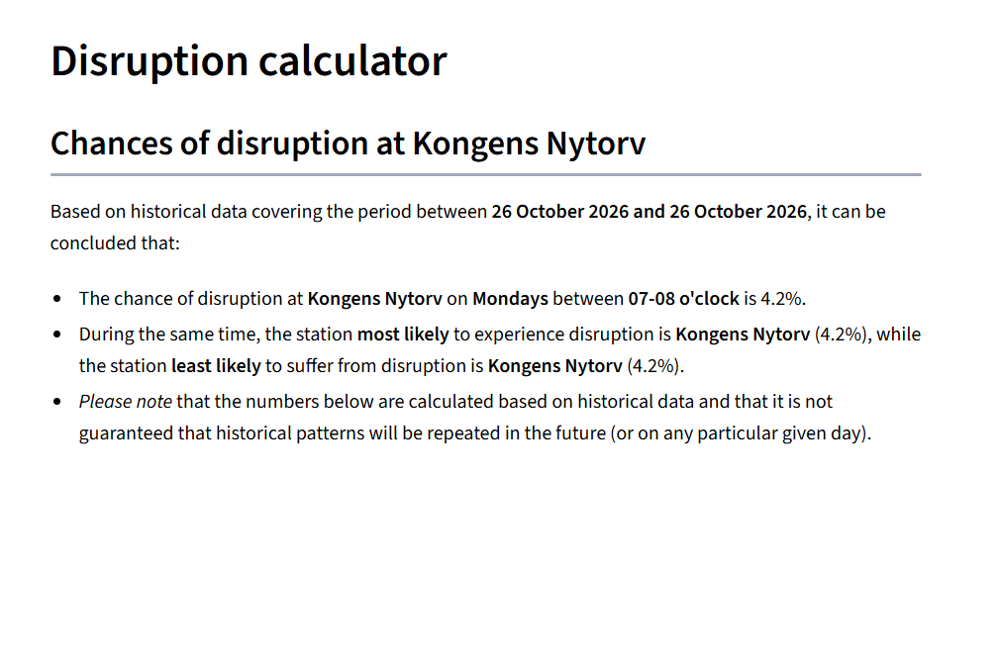 | Allows the user to calculate the probability that a service disruption will occur at a given station at a given point in time (based on historical data) |
| **About this app** | 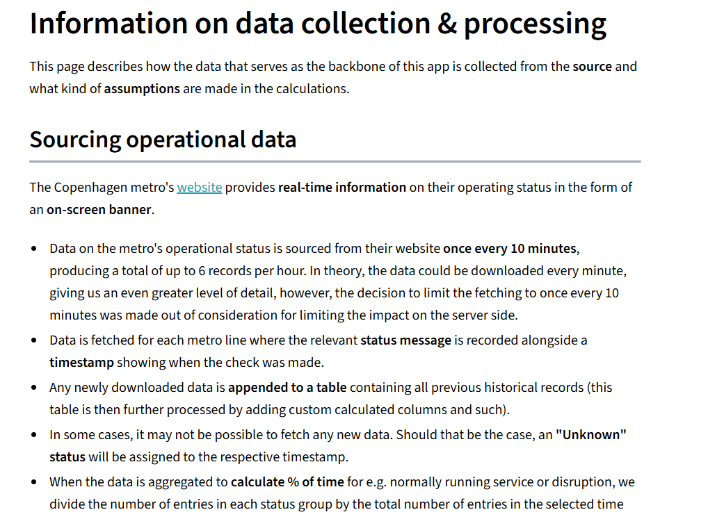 | Contains information on how the data is sourced and cleaned, a preview of the service status mapping table and system downtime |
| **Legal disclaimer** | 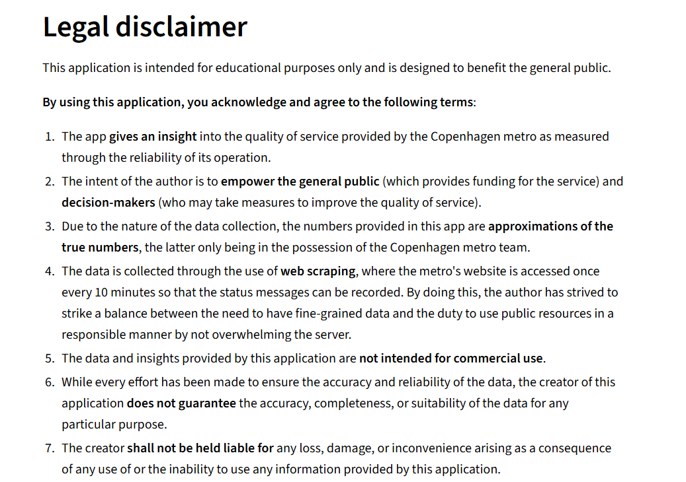 | Creates the "terms of service" for using the app as well as other relevant legal information |

### Filters in the app

The user can interact with the app by filtering the data. On most pages, the following filters are available:

- Time period to cover
- Kinds of days to show (weekdays and/or weekends)
- Kinds of hours to show (regular hours and/or morning/evening rush hours)
- Metro lines to show (M1, M2, M3, M4)
- Include or exclude periods of data scraper downtime (which increases/decreases the number of *Unknown* entries showed on the charts)

To get to know how to use the filters, please read the *How do I filter the data?* section further down in this `README`.

## How to use the app

This app presents information on the Copenhagen Metro's **operational status over time**, allowing to measure the impact of the disruptions caused to passengers on different lines, stations and different times of the day/week.

### What information does the app contain?

This app focuses on keeping track of the Copenhagen Metro's service status and aggregating that data in meaningful ways, allowing you to **find answers to questions such as**:

- How often has the metro run according to schedule in the past N days?
- How often has the metro experienced disruptions either due to maintenance or unexpected issues?
- What were the main causes behind the disruptions that occurred in the selected time period?
- Which days of the week saw the highest number of disruptions and which stations were most impacted by them?
- Have there been any improvements/a worsening in the share of time where the metro ran according to schedule in the selected time period?

### How do I navigate between the app's pages?

**The sidebar** on the left hand side allows you to navigate between the different pages included in the app as well as to apply different filters on the data, such as choosing how many days of data to include in the calculations that  generate the data shown on the charts.

To **switch between different pages**, please click on the page title:

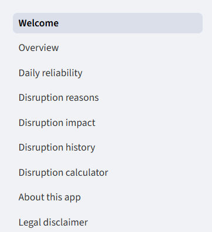

Charts, tables and text descriptions are displayed in the app's **main panel** to the right.

### How do I filter the data?

To **apply a filter to the data**, please click on the filter you wish to apply and select the desired value(s). Please note that the filter that lets you decide the **timespan** of historical data to show requires selecting both a *start date* and an *end date*. By default, it is set to display the last 30 days:

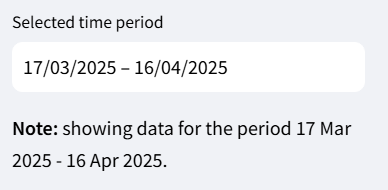

All other filters support **choosing multiple values** at the same time. By default, all values are kept:

**Please note** that if you filter the data too much or remove all pre-made selections, there might not be enough data left to display on the charts and the app may revert to selecting something for you. Should that be the case, a **warning message** will be displayed such as the one below:

To get rid of the warning, please revise your selection or refresh the web page to start over.

## Back-end architecture

- Each page in the app is contained in an individual Python script within the `pages` folder.
- The app is launched from the `app.py` script, which contains references to the individual page scripts mentioned above.
- Functions related to layout definition, input data loading, etc. that are reused across pages are contained in several Python scripts located in the `core` folder.
- Charts and other visuals in the app are constructed using the `plotly` and `calplot` libraries.
- Input data for the app is loaded from a local `duckdb` database, the latest version of which is loaded from S3-compatible storage once every hour (the data sourcing and processing happens in [this repository]((https://github.com/cyrilby/cph-metro-status)).
- The app's overall theme is defined in `.streamlit/config.toml` file, while the theme for the `plotly` charts is defined in `interface.py` script.

## Planned improvements

The *Disruption calculator* page will be made more interactive in the future.